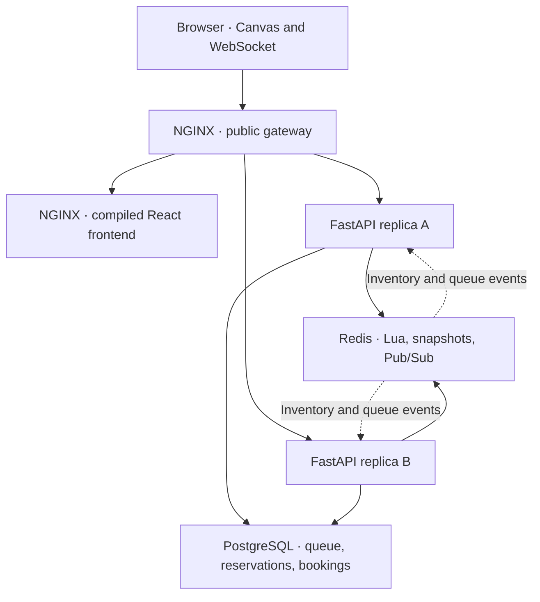

# SeatSurge architecture

Each replica has a local WebSocket subscriber and uses the same signed session secret. Sessions, queue order, admission deadlines, temporary reservations, and checkout records have shared storage. PostgreSQL holds a durable copy of the committed queue and active reservations.

## Inventory and checkout

1. A PostgreSQL advisory lock serializes writes for an event. The API marks the Redis projection dirty before the write transaction. New writes rebuild a dirty or restarted Redis projection from committed PostgreSQL rows under the same lock.
2. The Redis hold script checks admission, rejects any occupied seat, and reserves the entire group in one operation using the Redis clock. The API persists the hold and deadline before returning. The SQL ticket and reservation checks also protect against stale Redis occupancy.
3. Checkout atomically moves the Redis reservation to `COMMITTING` before its deadline. Simulated payment, booking, tickets, reservation status, and queue completion share a PostgreSQL transaction. The idempotency key is serialized and unique. The ticket uniqueness constraint protects the event seat permanently.
4. The API marks the seat sold after commit. When projection fails, the dirty marker remains or the Redis server identity changes. Reconciliation then projects the committed SQL result before another write can allocate those seats.
5. The expiry worker acquires the same event lock and consults PostgreSQL before releasing a group. A lost checkout transaction rolls back. A committed one is recovered by replay or from the booking endpoint.

## Client reconciliation

A cached snapshot has a generation and version. The generation changes after rebuild. The browser applies contiguous deltas, fetches a fresh snapshot on reconnect or a version gap, and checks the lightweight version endpoint once a second. Queue clients receive updates over WebSocket and poll as a fallback.

## Operational boundaries

Only NGINX publishes a port by default. Cookie signatures authorize customer ownership. Admin uses an environment-configured bearer credential. Test operations require explicit demo mode, use temporary events and sessions, and clean up those records after each run.
